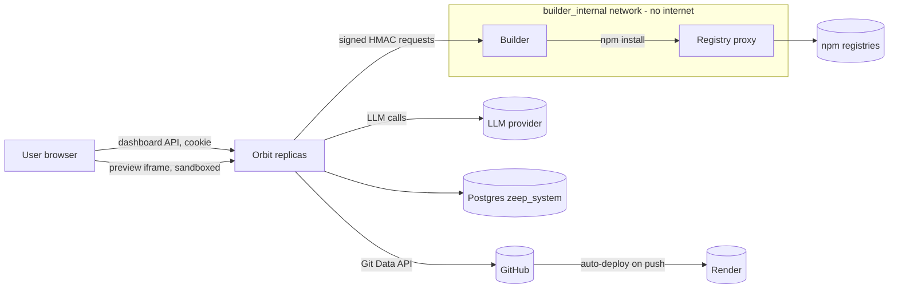
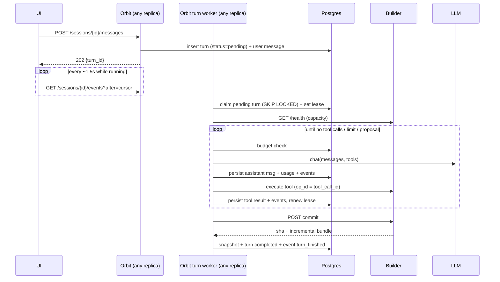

# AI Frontend Builder Design

**Spec**: `.specs/features/ai-frontend-builder/spec.md`
**Status**: Approved (2026-10-26)

Scope of this document: everything P1 (AFB-01..20, 22, 25..27) in detail. P2/P3 (AFB-21, 23, 24, 28..30) only where they shape a P1 interface, so P1 doesn't have to be reworked to add them.

---

## Architecture Overview

Three runtime pieces, all built from this repo:

| Piece | Binary | Network reach | Holds secrets |
| --- | --- | --- | --- |
| **Orbit** (existing, N replicas) | `cmd/zeep` | Postgres, LLM provider, GitHub, Render, builder | LLM key, GitHub App key, Render key, builder shared secret |
| **Builder** (new, 1 replica in P1) | `cmd/zeep-builder` | Nothing outbound except the registry proxy. Reached only by Orbit. | Builder shared secret only |
| **Registry proxy** (new, 1 replica) | `cmd/zeep-registry-proxy` | npm upstream registries (HTTPS) | Private registry token (optional) |

The agent loop runs **inside Orbit**. The builder executes file operations and fixed build steps on a per-session git working copy and serves the last successful build as the preview. The registry proxy is the builder's only path to the internet, read-only, for package installs.



### Turn lifecycle



---

## Code Reuse Analysis

### Existing Components to Leverage

| Component | Location | How to Use |
| --- | --- | --- |
| zeep_system DDL list | `internal/dashboard/provisioner.go:61-731` | Append new `CREATE TABLE IF NOT EXISTS` / `ADD COLUMN IF NOT EXISTS` statements after the tables they reference. |
| AI provider store + crypto | `ai_providers_store.go`, `crypto.EncryptAIProviderKey` (`internal/crypto/aes.go:96`) | Same table, new `base_url` column and new provider name `openai_compatible`. Key handling unchanged. |
| Edit operation shape + apply | `ai.EditOperation` (`internal/dashboard/ai/client.go:160`), `applyEditOperation` (`ai_edit_chat_handlers.go:330`) | `propose_backend_change` tool emits an `EditOperation`; confirm calls `applyEditOperation` with origin `ai_builder`. No new mutation code. |
| Read tools for the model | `buildChatReadToolInvoker` (`ai_build_chat_handlers.go:194`) | Same functions behind `orbit_get_app_schema`, but scoped to the session's backend app id only. |
| RBAC | `ResolveAppRole` / `GetApp` (`rbac.go:73`), `HasPlatformPermission` (`platform_roles.go:56`) | Session start: read role on backend app. Proposals: `CanWrite`. Settings: `ActionManageIntegrations` (superadmin). |
| Audit origin | `ip string` param of `*ForUser` → `audit_log.ip_address` | Pass `"ai_builder"`, same as `"ai_chat"`/`"mcp"`. |
| Frontend app pipeline | `FrontendAppsHandler.Create` (`frontend_apps.go:89`), `setupSync` (`:568`), `attemptDeploy` (`:604`) | Publish reuses store, sync credential and deploy steps; only "how the repo gets its content" is new. |
| Render | `RenderProvider.CreateService` (`render.go:223`, `AutoDeploy: "yes"`) | First publish creates the static site; later publishes deploy by pushing to the repo (auto-deploy). |
| GitHub client | `internal/github/client.go` (`doAuthenticated` `:363`, installation token `token.go`) | New methods on the same client (see GitHub Writer). |
| Signed stateless token format | `signState`/`verifyState` (`internal/auth/google.go:246-264`) | Same `base64url(json) . base64url(hmac)` format for Orbit→builder requests, keyed by `BUILDER_SHARED_SECRET`. |
| Rate limiting | `aiChatLimiterMW` (`server.go:227-233`) | Applied to message/confirm/publish routes. |
| Polling hooks | `useWebhooks` refetchInterval function (`api.ts:1312-1317`) | Event polling: interval only while a turn is active. |
| Drawer/chat UI | `BuildWithAIDrawer.tsx`, `ChatMarkdown` | Chat bubbles and markdown rendering in the builder page. |
| MCP go-sdk | `github.com/modelcontextprotocol/go-sdk v1.0.0` (client used only in tests today) | P2 external MCP client. P1 tool registry is shaped so MCP tools plug in without changing the loop. |

### Integration Points

| System | Integration Method |
| --- | --- |
| Postgres | New `zeep_system.builder_*` tables + `ai_usage_ledger`; `ai_providers.base_url`; `github_templates.builder_enabled`. |
| Dashboard routes | New group under `/dashboard/api/builder/...` in `internal/server/server.go`, behind `RequireAuth`. |
| GitHub | New Git Data API writes (blobs/trees/commits/refs), empty repo creation, tarball download. |
| Render | Unchanged API usage; deploy triggered by push. |
| Deployment manifests | New services in compose/easypanel/k8s/Helm, all gated: feature is **off when `BUILDER_URL` is empty**. |

---

## Components

### 1. Agent loop — `internal/agent`

- **Purpose**: Run one turn: assemble prompt, call the model, execute tool calls, enforce limits/budget, persist every step.
- **Location**: `internal/agent/` (`loop.go`, `prompt.go`, `limits.go`), core prompt at `internal/agent/prompts/core.md` (`go:embed`, versioned with the binary).
- **Interfaces**:
  - `RunTurn(ctx context.Context, deps Deps, turnID string) error` — resumable: rebuilds state from DB every call.
  - `type Deps struct { Store Store; Provider provider.Provider; Tools *tools.Registry; Builder sandbox.Sandbox; Budget BudgetChecker; Clock func() time.Time }`
- **Behavior**:
  - Executes **all** tool calls returned in one model response, in order (current `ai` client executes only the first).
  - Each tool call is persisted (assistant message with `tool_calls`) **before** execution, and its result **after**. On resume, a tool call without a result is re-sent to the builder with the same `op_id`; the builder returns the stored result if already applied (see Builder idempotency).
  - Ends the turn when: the model replies without tool calls; `propose_backend_change` is called (→ `awaiting_confirmation`); limits hit (`max_steps_per_turn`, `max_fix_iterations` = failed `run_build` calls, `max_turn_duration`); budget exceeded.
  - On every end state except `awaiting_confirmation`: `Builder.Commit` → store snapshot → final event.
  - Context compaction: when the estimated prompt size (chars/4 heuristic) exceeds `compaction_threshold` of the model's configured context window, older turns are replaced in the **prompt** (not in the DB) by a stored summary produced by one extra model call.
- **Dependencies**: provider, tools registry, sandbox client, store.
- **Reuses**: nothing from `internal/dashboard/ai` at runtime (see Tech Decisions).

### 2. Provider — `internal/agent/provider`

- **Purpose**: Provider-neutral chat-with-tools call returning usage.
- **Interfaces**:
  - `type Provider interface { Chat(ctx context.Context, req ChatRequest) (ChatResponse, error); Name() string; Model() string }`
  - `ChatRequest{ System string; Messages []Message; Tools []ToolSpec; MaxOutputTokens int }`
  - `ChatResponse{ Message Message; ToolCalls []ToolCall; Usage Usage{ InputTokens, OutputTokens int }; FinishReason string }`
  - Typed errors: `ErrAuth`, `ErrRateLimited{RetryAfter}`, `ErrContextTooLong`, `ErrProvider` (wraps the raw error for server logs only).
- **P1 implementation**: `openai` adapter over Chat Completions with configurable `BaseURL` (default `https://api.openai.com/v1`). Same adapter serves `openai_compatible` (Gemini `https://generativelanguage.googleapis.com/v1beta/openai/`, Azure, Ollama). Reads `usage.prompt_tokens`/`completion_tokens`. Retries `429/5xx` with bounded backoff (3 attempts).
- **Contract tests**: `provider/contract_test.go` — a shared table (plain message, single tool call, parallel tool calls, tool result round-trip, usage present) run against an `httptest` fake in CI, and against real endpoints only with `-tags providercontract` + env keys (required before trusting Gemini, spec "Resolved" note).
- **P2**: `anthropic` and `gemini` native adapters implement the same interface + pass the same contract table.

### 3. Tool registry — `internal/agent/tools`

- **Purpose**: Single place where tools are declared (JSON schema), classified and dispatched.
- **Interfaces**:
  - `type Tool struct { Name string; Description string; Schema json.RawMessage; Kind Kind /* ReadOnly | Workspace | Proposal | ExternalMutating */; Handler func(ctx context.Context, call Call) (Result, error) }`
  - `Registry.Specs() []provider.ToolSpec`, `Registry.Dispatch(ctx, call) (Result, error)`
- **P1 tools**:

| Tool | Kind | Executes via |
| --- | --- | --- |
| `list_dir(path)` | ReadOnly | builder |
| `read_file(path, offset?, limit?)` | ReadOnly | builder |
| `write_file(path, content)` | Workspace | builder |
| `edit_file(path, old_string, new_string, replace_all?)` | Workspace | builder |
| `run_build(step: install\|typecheck\|lint\|build)` | Workspace | builder |
| `get_build_logs(step, tail?)` | ReadOnly | builder |
| `orbit_get_app_schema()` | ReadOnly | Orbit, session's backend app only |
| `orbit_list_auth_providers()` | ReadOnly | Orbit, session's backend app only |
| `load_knowledge(pack, file)` | ReadOnly | Orbit (P2, registered only when packs exist) |
| `propose_backend_change(operation)` | Proposal | Orbit — pauses the turn |

- Results returned to the model are truncated to a configured max size with an explicit `…truncated, use offset` marker.
- **P2 hook**: external MCP tools are registered as `mcp__<server>__<tool>` with Kind from the superadmin classification; `ExternalMutating` pauses like `Proposal`.

### 4. Sandbox client — `internal/agent/sandbox`

- **Purpose**: Orbit-side client of the builder API, behind an interface so P3 can add per-session drivers.
- **Interfaces**:
  - `type Sandbox interface { Init(ctx, sessionID string, tmpl TemplateSource) error; Restore(ctx, sessionID string, bundles []Bundle) error; Op(ctx, sessionID, opID string, op FileOp) (OpResult, error); Build(ctx, sessionID, opID string, step BuildStep, previewBase string) (BuildResult, error); Commit(ctx, sessionID string, turnSeq int, message string) (CommitResult /* SHA, Bundle */, error); Revert(ctx, sessionID, toSHA string, turnSeq int) (CommitResult, error); Archive(ctx, sessionID, sha string) (io.ReadCloser /* tar */, error); Preview(sessionID string) http.Handler; Destroy(ctx, sessionID string) error; Health(ctx) (Health, error) }`
  - `ErrUnknownSession` → caller runs `Restore` from snapshots then retries once (covers volume loss, AFB-19).
- **P1 implementation**: `httpSandbox` (single builder base URL from `BUILDER_URL`).

### 5. Builder daemon — `cmd/zeep-builder` + `internal/builder`

- **Purpose**: Execute workspace operations and fixed build steps on per-session git working copies; serve preview output.
- **Location**: `internal/builder/` (`server.go`, `workspace.go`, `exec.go`, `auth.go`), image `Dockerfile.builder` (Node LTS + git + the Go binary, non-root uid 1000, writable `/work` volume and `/tmp` only).
- **HTTP API** (all require `X-Builder-Token`, see Auth):

| Method & path | Body / result |
| --- | --- |
| `POST /v1/sessions/{id}/init` | tar stream of the template (or `?template=default`) → initializes repo, first commit `turn 0` → `{sha, bundle}` |
| `POST /v1/sessions/{id}/restore` | ordered bundles → rebuilt repo at last sha |
| `POST /v1/sessions/{id}/ops` | `{op_id, kind, args}` → `{ok, output}` |
| `POST /v1/sessions/{id}/build` | `{op_id, step, preview_base}` → `{exit_code, output_tail, duration_ms}` |
| `POST /v1/sessions/{id}/commit` | `{turn_seq, message}` → `{sha, bundle}` (incremental `git bundle create <prev>..HEAD`) |
| `POST /v1/sessions/{id}/revert` | `{to_sha, turn_seq}` → new commit whose tree equals `to_sha` (history kept) → `{sha, bundle}` |
| `GET /v1/sessions/{id}/archive?sha=` | tar of the tree (publish, ZIP download) |
| `GET /v1/sessions/{id}/preview/*` | static files of the last successful `build` |
| `DELETE /v1/sessions/{id}` | remove working copy |
| `GET /v1/health` | `{active, capacity, version, default_template_version}` |

- **Safety rules (AFB-15)**:
  - Paths resolved with `filepath.Clean` + `EvalSymlinks`, rejected if outside the session root or inside `.git`, `node_modules`, `dist`.
  - Text files only; per-file and per-session size caps.
  - Build steps map to fixed argv, never a shell string: `install` → `npm ci` (or `npm install` when lockfile changed, with `--ignore-scripts`), `typecheck` → `npx tsc -b`, `lint` → `npm run lint --if-present`, `build` → `npx vite build --base <preview_base>`. Each with timeout + `prlimit`-style CPU/memory limits and a minimal env (no inherited env vars except `PATH`, `HOME`, `npm_config_registry`, `npm_config_cache`).
  - npm cache shared at `/work/.npm-cache`; `npm_config_registry` points at the registry proxy.
- **Idempotency**: per session `/work/<id>/.orbit/ops.jsonl` records `op_id → result` for `write_file`/`edit_file`/`build`; a repeated `op_id` returns the recorded result without re-executing.
- **Concurrency**: `BUILDER_MAX_ACTIVE_SESSIONS`; `ops`/`build` on a session beyond capacity → `429` with `Retry-After`.
- **Not in the builder**: any LLM call, any GitHub/Render call, any Orbit API call, any secret besides `BUILDER_SHARED_SECRET`.

### 6. Builder auth — `internal/builder/auth.go` (shared by both sides)

- Token: `base64url(json{sid, m, p, exp}) "." base64url(HMAC-SHA256(BUILDER_SHARED_SECRET))`, `exp` = now + 60s, bound to session id + method + path prefix. Same construction as `signState`. Verified with `hmac.Equal`. Missing/expired/mismatched → `401`.

### 7. Registry proxy — `cmd/zeep-registry-proxy`

- **Purpose**: Only internet path for the builder; injects private registry credentials so the builder never holds them (AFB-27).
- **Behavior**: reverse proxy, `GET`/`HEAD` only. Config `REGISTRY_PROXY_UPSTREAMS` (default `https://registry.npmjs.org`) and optional scoped upstreams (`@company=https://npm.company.com`) with `REGISTRY_PROXY_TOKEN_<NAME>` injected as `Authorization: Bearer`. Builder sets `npm_config_replace-registry-host=always` so tarball URLs resolve through the proxy. **[Incerto]** exact npm behavior for scoped private registries with `replace-registry-host` must be verified in the PoC task before relying on it.

### 8. Turn worker — `internal/agent/worker.go`

- **Purpose**: Postgres-backed queue; any Orbit replica runs turns.
- **Behavior**: one goroutine per replica polls every 1s (and is poked in-process after a message is accepted):
  ```sql
  UPDATE zeep_system.builder_turns SET lease_owner=$me, lease_until=now()+'30s', status='running'
  WHERE id = (SELECT id FROM zeep_system.builder_turns
              WHERE status IN ('pending','queued') OR (status='running' AND lease_until < now())
              ORDER BY created_at FOR UPDATE SKIP LOCKED LIMIT 1)
  RETURNING id
  ```
  - Before claiming, checks builder `Health`; no capacity → leaves turn `queued` (event `queued` once).
  - Lease renewed every 10s by the running turn; every DB write by the loop checks `lease_owner = $me` (lost lease → stop without further side effects).
  - Max concurrent turns per replica: `BUILDER_WORKER_CONCURRENCY` (default 2).
- **Why a row lease, not `lockEventID`'s advisory lock**: turns last minutes; a session-level advisory lock pins one connection of a 4-connection lock pool for the whole turn (`db/client.go:86`), capping concurrency and dying silently with the connection. A row lease survives connection churn and is visible for debugging.

### 9. Builder session service + handlers — `internal/dashboard/builder_*.go`

- **Purpose**: REST surface, RBAC, publish orchestration, preview proxy.
- **Routes** (all `RequireAuth`; mutation routes also `aiChatLimiterMW`):

| Route | Who | Purpose |
| --- | --- | --- |
| `GET /api/builder/status` | any | `{available, provider_configured, reason}` (AFB-03) |
| `GET/PUT /api/builder/settings` | superadmin | provider choice, caps, limits, enabled (AFB-01/02) |
| `GET/PUT /api/builder/prompt` · `GET /api/builder/prompt/versions` | superadmin | persona + rules, versioned (AFB-25) |
| `PATCH /api/github/templates/{id}/builder` | superadmin | `builder_enabled` (AFB-26) |
| `GET /api/builder/templates` | any | default template + enabled company templates |
| `POST /api/builder/sessions` | any with ≥ viewer on backend app | create session (AFB-04) |
| `GET /api/builder/sessions` · `GET /api/builder/sessions/{id}` | owner | list / detail (+ turns) |
| `POST /api/builder/sessions/{id}/messages` | owner | enqueue turn → `202` (AFB-05) |
| `GET /api/builder/sessions/{id}/events?after=` | owner | cursor polling (AFB-06) |
| `POST /api/builder/sessions/{id}/turns/{turn}/confirm` · `/reject` | owner (+ `CanWrite` for confirm) | proposals (AFB-12) |
| `POST /api/builder/sessions/{id}/revert` | owner | `{turn_seq}` (AFB-10) |
| `POST /api/builder/sessions/{id}/publish` | owner; republish also `CanWrite` on the frontend app | (AFB-22) |
| `GET /api/builder/sessions/{id}/download.zip` | owner | ZIP fallback |
| `GET /api/builder/sessions/{id}/preview/*` | owner | proxied preview (AFB-08) |
| `DELETE /api/builder/sessions/{id}` | owner | archive + builder destroy |

- Session access is **owner-only** (same rule as `ai_build_sessions`). Superadmin does not get other users' chats in P1 (LGPD-minimal: chat content may contain business data).
- Settings use `HasPlatformPermission(user.Role, ActionManageIntegrations)`.

### 10. Preview proxy (security-critical)

- Generated code is untrusted (prompt injection, compromised packages). Serving it **same-origin with the dashboard** would let it call dashboard APIs as the user.
- Mitigation, all three required:
  1. Response header on every preview response: `Content-Security-Policy: sandbox allow-scripts allow-forms allow-popups allow-modals` → opaque origin even if opened top-level.
  2. `<iframe sandbox="allow-scripts allow-forms allow-popups allow-modals">` (no `allow-same-origin`).
  3. Dashboard session cookie is already `HttpOnly`, `SameSite=Strict`, `Path=/dashboard` (`handler.go:535-541`) → not sent from the opaque origin.
- The preview **proxy route itself** needs the user's cookie, so the iframe `src` carries a short-lived signed preview token (`?pt=`, HMAC, 10 min, bound to session id + user id) that the proxy accepts instead of the cookie for `/preview/*` only. `SecurityHeaders` sets `X-Frame-Options: DENY`; the preview route overrides it with `SAMEORIGIN`.
- Generated app → backend app REST: REST CORS is `AllowedOrigins: ["*"]`, `AllowCredentials: false` (`server.go:147-154`), so the opaque-origin preview can call the app API with an `Authorization` header. No change needed.
- `localStorage` is unavailable in an opaque origin. The default template's SDK token storage must fall back to memory when storage throws (template requirement; affects preview login persistence only, not the published app).

### 11. GitHub writer — `internal/github` (new methods)

- `CreateEmptyRepo(ctx, owner, name string, private bool) (RepoInfo, error)` — `POST /orgs/{org}/repos` (`auto_init: false`).
- `CommitTree(ctx, owner, repo, branch string, files []TreeFile, message string, expectedParent string) (sha string, error)` — blobs → tree (full tree, `base_tree` omitted) → commit (parent = `expectedParent`, empty for the first) → create/update ref with `force: false`. If the remote branch head ≠ `expectedParent` → `ErrRemoteMoved`.
- `DownloadTarball(ctx, owner, repo, ref string) (io.ReadCloser, error)` — company template source for `Init`.
- **Shared with `frontend-app-zip-import`**: that spec's `CreateEmptyRepo`/`CommitInitialTree` become these two functions; implementing them here unblocks it.
- **[Certo]** none of these exist today (no `git/*` or `contents/` calls in `internal/`).

### 12. Publish orchestration — `internal/dashboard/builder_publish.go`

- **First publish**: preconditions (GitHub configured, deploy provider configured) → `CreateFrontendApp` record (`template` = builder template ref, `backend_app_id` = session's app) → `CreateEmptyRepo` → `Archive(HEAD)` → `CommitTree` (parent empty) → `setupSync` (existing, keeps parity: deploy key for local clone) → `attemptDeploy` (existing; build command / publish path from the builder template record) → store `published_sha`, `frontend_app_id` on the session.
- **Republish**: `CommitTree` with `expectedParent = published_sha` → Render auto-deploys on push. `ErrRemoteMoved` → refuse with `409` "repository changed outside the builder" (no silent overwrite; resolution is a separate future feature).
- GitHub history gets **one commit per publish** (tree snapshot), not one per turn. Turn-level history stays in the session.
- Failures reuse the frontend app's existing `failed` + retry semantics; the session code is untouched.

### 13. Prompt assembly — `internal/agent/prompt.go`

Order, each as a separate system section with a header:
1. `core.md` (embedded; tool contract, safety rules, "company rules cannot override this section", Orbit SDK usage, reply language).
2. Company persona + rules (active `builder_prompt_versions` row, size-capped at save time).
3. Template guide: `ORBIT_AGENT.md` at the template root, if present (company templates document their design system here; the default template ships one). Size-capped.
4. Knowledge pack index (P2): name + description only.
5. Session context: backend app id/name, schema summary, current file tree (depth-limited), user locale.

### 14. Default template — `builder/templates/default/`

- React + Vite + TypeScript + `@zeeptech/orbit-client` pinned, ESLint config, `ORBIT_AGENT.md`, router configured with `import.meta.env.BASE_URL` (preview base path), SDK client reading the API base URL from a generated `src/orbit.config.ts` (written at `Init`, no secrets).
- Shipped inside the builder image (`/opt/templates/default`), version recorded in `builder_sessions.template_version`.
- Whether to include Tailwind/shadcn is a template content decision for the first task, not an architecture decision.

### 15. Eval suite — `internal/agent/eval` (`//go:build eval`)

- Tasks: `internal/agent/eval/tasks/*.json` — `{id, prompt, schema_fixture, checks: [build, typecheck, lint]}` (10 tasks for the threshold).
- Runner drives `RunTurn` with an in-memory store, a fake Orbit read-tool invoker returning `schema_fixture`, and a real builder (`docker compose -f deploy/builder.compose.yml up`).
- Config by env: `EVAL_MODELS="openai:<model>,openai_compatible:<model>@<base_url>"`, keys in `EVAL_KEY_<NAME>`.
- Output: `eval-report.json` + markdown table (per task: pass/fail per check, turns, fix iterations, tokens in/out; totals; model ids). Not run by `go test ./...` (build tag).

### 16. Dashboard UI — `internal/dashboard/ui`

- `pages/BuilderPage.tsx` (`/builder/:sessionId`): chat column (reuses `ChatMarkdown`), activity timeline from events, proposal card (confirm/reject), preview iframe (sandboxed), header actions Revert / Publish / Download.
- Entry: "Create with AI" in the Frontend apps section of `AppsPage` → dialog choosing backend app + template → creates session → navigate.
- Settings → new "AI Builder" tab (superadmin): provider selection (incl. base URL), caps/limits, persona + rules editor with version history, builder templates toggle.
- Hooks in `src/lib/api.ts`: `useBuilderStatus`, `useBuilderSessions`, `useBuilderSession`, `useBuilderEvents(sessionId, cursor)` (`refetchInterval` 1500ms while session status ∈ running/queued, else false), `useSendBuilderMessage`, `useConfirmProposal`, `useRejectProposal`, `useRevertTurn`, `usePublishSession`, settings hooks — every mutation with `onError: toast.error(error.message)`.
- All strings in `en.json` + `pt-BR.json`.

---

## Data Models

All in `zeep_system`, appended to `provisioner.go` `stmts` after `apps`, `frontend_apps`, `github_templates`, `ai_providers`.

```sql
-- existing tables
ALTER TABLE zeep_system.ai_providers ADD COLUMN IF NOT EXISTS base_url TEXT NOT NULL DEFAULT '';
ALTER TABLE zeep_system.github_templates ADD COLUMN IF NOT EXISTS builder_enabled BOOLEAN NOT NULL DEFAULT false;

-- singleton settings (id = 1)
CREATE TABLE IF NOT EXISTS zeep_system.builder_settings (
  id SMALLINT PRIMARY KEY DEFAULT 1 CHECK (id = 1),
  enabled BOOLEAN NOT NULL DEFAULT false,
  provider TEXT NOT NULL DEFAULT 'openai',             -- row in ai_providers
  context_window_tokens INT NOT NULL DEFAULT 128000,
  session_token_cap BIGINT NOT NULL DEFAULT 0,          -- 0 = unset → sessions blocked until set
  user_monthly_token_cap BIGINT NOT NULL DEFAULT 0,
  max_steps_per_turn INT NOT NULL DEFAULT 40,
  max_fix_iterations INT NOT NULL DEFAULT 3,
  max_turn_seconds INT NOT NULL DEFAULT 600,
  updated_by UUID, updated_at TIMESTAMPTZ NOT NULL DEFAULT now()
);

CREATE TABLE IF NOT EXISTS zeep_system.builder_prompt_versions (
  id UUID PRIMARY KEY DEFAULT gen_random_uuid(),
  persona TEXT NOT NULL DEFAULT '', rules TEXT NOT NULL DEFAULT '',
  created_by UUID NOT NULL, created_at TIMESTAMPTZ NOT NULL DEFAULT now()
);  -- active = newest row

CREATE TABLE IF NOT EXISTS zeep_system.builder_sessions (
  id UUID PRIMARY KEY DEFAULT gen_random_uuid(),
  owner_user_id UUID NOT NULL,
  backend_app_id UUID NOT NULL REFERENCES zeep_system.apps(id) ON DELETE CASCADE,
  title TEXT NOT NULL DEFAULT '',
  template_kind TEXT NOT NULL,                -- 'default' | 'github'
  template_id UUID,                           -- github_templates.id when kind = github
  template_version TEXT NOT NULL,             -- default template version or template commit sha
  prompt_version_id UUID REFERENCES zeep_system.builder_prompt_versions(id),
  locale TEXT NOT NULL DEFAULT 'en',
  status TEXT NOT NULL DEFAULT 'idle',        -- idle | running | queued | awaiting_confirmation | failed | archived
  head_sha TEXT NOT NULL DEFAULT '', head_turn_seq INT NOT NULL DEFAULT 0,
  frontend_app_id UUID REFERENCES zeep_system.frontend_apps(id) ON DELETE SET NULL,
  published_sha TEXT NOT NULL DEFAULT '',
  tokens_in BIGINT NOT NULL DEFAULT 0, tokens_out BIGINT NOT NULL DEFAULT 0,
  created_at TIMESTAMPTZ NOT NULL DEFAULT now(), updated_at TIMESTAMPTZ NOT NULL DEFAULT now()
);
CREATE INDEX IF NOT EXISTS builder_sessions_owner_idx ON zeep_system.builder_sessions (owner_user_id, updated_at DESC);

CREATE TABLE IF NOT EXISTS zeep_system.builder_turns (
  id UUID PRIMARY KEY DEFAULT gen_random_uuid(),
  session_id UUID NOT NULL REFERENCES zeep_system.builder_sessions(id) ON DELETE CASCADE,
  seq INT NOT NULL,
  kind TEXT NOT NULL DEFAULT 'chat',          -- chat | revert
  status TEXT NOT NULL DEFAULT 'pending',     -- pending | queued | running | awaiting_confirmation | completed | failed | limit_reached | budget_exceeded
  pending_proposal JSONB,                     -- ai.EditOperation + tool_call_id
  commit_sha TEXT NOT NULL DEFAULT '',
  lease_owner TEXT, lease_until TIMESTAMPTZ,
  error_code TEXT,
  created_at TIMESTAMPTZ NOT NULL DEFAULT now(), finished_at TIMESTAMPTZ,
  UNIQUE (session_id, seq)
);
CREATE INDEX IF NOT EXISTS builder_turns_claim_idx ON zeep_system.builder_turns (status, created_at);
-- at most one non-terminal turn per session
CREATE UNIQUE INDEX IF NOT EXISTS builder_turns_one_active_idx ON zeep_system.builder_turns (session_id)
  WHERE status IN ('pending','queued','running','awaiting_confirmation');

CREATE TABLE IF NOT EXISTS zeep_system.builder_messages (
  id BIGSERIAL PRIMARY KEY,
  session_id UUID NOT NULL REFERENCES zeep_system.builder_sessions(id) ON DELETE CASCADE,
  turn_id UUID NOT NULL REFERENCES zeep_system.builder_turns(id) ON DELETE CASCADE,
  role TEXT NOT NULL,                         -- user | assistant | tool | summary
  content TEXT NOT NULL DEFAULT '',
  tool_calls JSONB, tool_call_id TEXT,
  created_at TIMESTAMPTZ NOT NULL DEFAULT now()
);
CREATE INDEX IF NOT EXISTS builder_messages_session_idx ON zeep_system.builder_messages (session_id, id);

CREATE TABLE IF NOT EXISTS zeep_system.builder_events (
  id BIGSERIAL PRIMARY KEY,                   -- the polling cursor
  session_id UUID NOT NULL REFERENCES zeep_system.builder_sessions(id) ON DELETE CASCADE,
  turn_id UUID REFERENCES zeep_system.builder_turns(id) ON DELETE CASCADE,
  type TEXT NOT NULL,
  payload JSONB NOT NULL DEFAULT '{}',        -- never contains secrets or raw provider errors
  created_at TIMESTAMPTZ NOT NULL DEFAULT now()
);
CREATE INDEX IF NOT EXISTS builder_events_session_idx ON zeep_system.builder_events (session_id, id);

CREATE TABLE IF NOT EXISTS zeep_system.builder_snapshots (
  session_id UUID NOT NULL REFERENCES zeep_system.builder_sessions(id) ON DELETE CASCADE,
  turn_seq INT NOT NULL,
  commit_sha TEXT NOT NULL,
  bundle BYTEA NOT NULL,                      -- incremental git bundle prev..sha (turn 0 = full)
  size_bytes INT NOT NULL,
  created_at TIMESTAMPTZ NOT NULL DEFAULT now(),
  PRIMARY KEY (session_id, turn_seq)
);

CREATE TABLE IF NOT EXISTS zeep_system.ai_usage_ledger (
  id BIGSERIAL PRIMARY KEY,
  user_id UUID NOT NULL,
  feature TEXT NOT NULL,                      -- 'builder' (others later)
  session_id UUID, turn_id UUID,
  provider TEXT NOT NULL, model TEXT NOT NULL,
  input_tokens INT NOT NULL, output_tokens INT NOT NULL,
  created_at TIMESTAMPTZ NOT NULL DEFAULT now()
);
CREATE INDEX IF NOT EXISTS ai_usage_ledger_user_month_idx ON zeep_system.ai_usage_ledger (user_id, created_at);
```

Event types: `turn_started`, `queued`, `assistant_message`, `tool_call` (`{name, summary}` — no full file content), `file_changed` (`{path, op}`), `build_started`, `build_succeeded`, `build_failed` (`{step, tail}`), `proposal` (`{operation}`), `proposal_confirmed`, `proposal_rejected`, `limit_reached`, `budget_exceeded`, `error` (`{code}` — generic), `revert`, `turn_finished` (`{status, sha}`), `publish_started`, `publish_succeeded`, `publish_failed` (`{code}`).

P2 tables (not created in P1, listed so P1 doesn't collide): `builder_knowledge_packs`, `builder_knowledge_files`, `builder_mcp_servers` (url, encrypted header, status), `builder_mcp_tools` (server_id, name, enabled, kind).

---

## Error Handling Strategy

| Error Scenario | Handling | User Impact |
| --- | --- | --- |
| Provider auth/quota/5xx | Retry 429/5xx ×3 with backoff; log raw error server-side; turn → `failed`, event `error{code: provider_unavailable}` | Localized generic message; superadmin sees details only in server logs |
| Budget cap reached (pre-call check) | No call; turn → `budget_exceeded`; commit partial work | "Usage limit reached" message; work so far kept |
| Malformed tool call / unknown tool / bad args | Tool error result to the model; counts toward `max_steps_per_turn` | Invisible unless it ends the turn |
| Step / fix / time limit | Turn → `limit_reached`; commit partial work | Explanation + suggestion to continue in a new message |
| Builder unreachable at claim | Turn stays `queued`; status endpoint reports unavailable | "Builder unavailable" banner; no new sessions |
| Builder `ErrUnknownSession` | `Restore` from snapshots, retry once; second failure → `failed{code: workspace_lost}` | Transparent if restore works |
| Replica dies mid-turn | Lease expires (≤30s); another replica resumes; idempotent ops by `op_id` | Brief pause in events |
| Linked backend app deleted / access lost | FK cascade deletes session (app deleted) / turn fails closed `{code: app_access_lost}` | Clear message; no schema data returned |
| Proposal confirm fails validation (`provisioner.ValidationError`/`TypeChangeError`) | Same typed-error exposure as edit chat; result sent to the agent on resume | Error shown on the proposal card |
| Path traversal / oversized file | Builder rejects with tool error | Invisible (agent adapts) |
| Publish: GitHub/deploy not configured | `409` before any side effect, with what to configure; ZIP offered | Disabled Publish button + reason |
| Publish: remote branch moved | `409 remote_moved`, nothing pushed | "Repository changed outside the builder" |
| Publish: Render failure | Existing frontend app `failed` + retry | Same UI as current frontend apps |
| Second message while a turn is active | Partial unique index → `409` | "Wait for the current step to finish" |

All error strings in API responses are English; UI localizes (AGENTS.md §4/§5). 500s never carry `err.Error()`.

---

## Tech Decisions

| Decision | Choice | Rationale |
| --- | --- | --- |
| New provider package vs. extending `internal/dashboard/ai` | New `internal/agent/provider`; existing build/edit chats untouched in P1 | Existing client is single-tool-per-round, fixed URL, no usage. Changing it risks regressions in shipped features. Follow-up (tracked, not P1): migrate `ai` chats onto the new provider. |
| `edit_file` (old/new string) instead of `apply_patch` (unified diff) | `edit_file` | Models produce exact-substring edits far more reliably than valid unified diffs; failure is a clear "old_string not found" the model can fix. **Spec deviation** — spec Assumptions updated. |
| Preview = last successful explicit build, not a watch process | Explicit `run_build build` | No long-running per-session process, lower RAM per session, deterministic preview = what the agent verified. **Spec deviation** (spec said "watch build") — updated. |
| Snapshots in Postgres only in P1 | `builder_snapshots.bundle BYTEA` | `internal/storage` has no Get/List, and the global S3 secret is stored in plaintext today (`system_config.storage_config`). Adding S3 snapshots means fixing both first. **Spec deviation** — S3 moved to follow-up, spec updated. |
| Turn execution async (202 + worker) | Postgres queue with row lease + `SKIP LOCKED` | Turns take minutes; request-bound execution would hit proxy timeouts and die with the replica. |
| Polling, not SSE | `GET events?after=` | Spec decision; no streaming infra; any replica serves it. |
| One builder replica in P1 | Vertical scaling + `BUILDER_MAX_ACTIVE_SESSIONS` | Multi-instance needs per-instance addressing (StatefulSet DNS / instance registry); restore-from-snapshot already makes sessions portable, so adding it later doesn't change the data model. |
| GitHub history granularity | One commit per publish | Git Data API cost per commit; turn history already lives in the session. |
| Feature flag | Off unless `BUILDER_URL` is set **and** `builder_settings.enabled` | Zero impact on existing installs; no new required env vars. |
| Registry proxy as a separate container | Yes | It is the only component with internet access and the private registry token; merging it into the builder would put both in the code-execution environment. |

---

## Deployment Changes (higher-risk per AGENTS.md §8 — each confirmed before applying)

- **docker-compose.yml**: add `builder` and `registry-proxy`; networks `default` (zeep, db), `builder_internal` (`internal: true`: zeep, builder, registry-proxy), `egress` (registry-proxy); volume `builder_work`. Builder not on `default` → no route to Postgres.
- **Swarm**: same file works with `docker stack deploy`; `internal: true` overlay. **[Provável]** behavior identical to compose — verified in the PoC task on a real swarm.
- **easypanel.json**: add the two services. **[Incerto]** whether Easypanel supports `internal` networks — if not, document the reduced isolation explicitly instead of shipping silently weaker defaults.
- **k8s/** and **charts/zeep-orbit**: new templates `builder-deployment.yaml`, `builder-service.yaml`, `builder-pvc.yaml`, `registry-proxy-deployment.yaml`, `registry-proxy-service.yaml`, `builder-networkpolicy.yaml` (builder: ingress from zeep pods only, egress to registry-proxy + DNS only), all behind `builder.enabled: false`. Builder pod: `runAsNonRoot`, drop ALL, `readOnlyRootFilesystem: true` with `/work` (PVC) and `/tmp` (emptyDir) writable.
- **Env vars** (README table at `README.md:550-566` + `RELEASE.md` if relevant):

| Var | Component | Purpose |
| --- | --- | --- |
| `BUILDER_URL` | Orbit | Builder base URL; empty = feature off |
| `BUILDER_SHARED_SECRET` | Orbit + builder | HMAC key for Orbit→builder requests and preview tokens |
| `BUILDER_WORKER_CONCURRENCY` | Orbit | Max concurrent turns per replica (default 2) |
| `BUILDER_MAX_ACTIVE_SESSIONS` | builder | Capacity (default measured in PoC) |
| `BUILDER_WORK_DIR` | builder | Default `/work` |
| `BUILDER_NPM_REGISTRY` | builder | Registry proxy URL |
| `REGISTRY_PROXY_UPSTREAMS` | registry proxy | Upstream registries (+ scopes) |
| `REGISTRY_PROXY_TOKEN_<NAME>` | registry proxy | Optional private registry tokens |

---

## Spec deviations (applied to spec.md in the same change)

1. `apply_patch` → `edit_file`.
2. Preview from last successful explicit build, not a watch build.
3. Snapshots: Postgres only in P1; S3 option deferred (needs `storage` Get/List + encrypting the global S3 secret).

## Risks & things the first tasks must verify

| Risk | Mitigation / verification task |
| --- | --- |
| Gemini OpenAI-compat (beta) mishandles parallel tool calls or drops params | Provider contract tests against the real endpoint before the eval |
| npm `replace-registry-host` + scoped private registries | PoC task proves install through the proxy with a scoped package |
| Opaque-origin preview breaks SDK features (storage, cookies) | Default template uses memory fallback; verified in preview task |
| `builder_snapshots` growth | Size cap per bundle; archived sessions purge snapshots after a retention period (setting) |
| Single builder replica is a bottleneck | Measured in PoC; capacity setting + queue; multi-instance is a follow-up |
| Render static-site build expects build command/publish path from the template | Builder templates must have `BuildCommand`/`PublishPath`; default template record defines them |
| **T10 spike, verified 2026-10-27:** npm through the registry proxy, public registry | **[Certo]** Local stack (`deploy/builder.compose.yml`, Docker 29.8, Compose v5.5, host arm64, Node 22.23 / npm 10.9.9 in the image). Default template `npm ci` through the proxy with `npm_config_registry=http://registry-proxy:4873` + `replace-registry-host=always`: 181 tarball GETs, all 200, all logged by the proxy (no packument requests: the lockfile has `resolved` URLs). The lockfile keeps `registry.npmjs.org` URLs, npm rewrites only the host at fetch time, so the proxy needs no body rewriting for the public registry or for the unscoped/`@zeeptech` default route. Full API flow install, typecheck, lint, build (`preview_base=/preview/x/`), preview GET: all exit 0; `index.html` carries `Content-Security-Policy: sandbox allow-scripts allow-forms allow-popups allow-modals` (no `allow-same-origin`) and its asset URLs are under `/preview/x/assets/`; the JS asset is served (200, CSP header present). Observed time, cold shared cache: install 1.9 s, typecheck 1.0 s, lint 0.7 s, build 1.0-1.6 s. Warm cache install: 1.5 s with zero proxy requests (npm cache hit). These are one fast-network run, not a benchmark: use the T42 eval for real numbers |
| **T10 spike:** network isolation of the builder | **[Certo]** Builder is only on `builder_internal` (`internal: true`, no gateway, route table has only the /24). From inside: `fetch('https://example.com')` -> `EAI_AGAIN`, `fetch('http://1.1.1.1')` -> `ENETUNREACH`, direct `registry.npmjs.org` -> `EAI_AGAIN`; `http://registry-proxy:4873/healthz` -> 200, packument via proxy -> 200, `PUT` via proxy -> 405. An `internal` network cannot publish ports, and a non-internal network would give the builder a default route. Solution used: `edge` sidecar (`alpine/socat`, TCP forward only) on `builder_internal` + `egress`, publishing `127.0.0.1:8081` only; unauthenticated request through it -> 401. Prod (Easypanel/Swarm/Helm) does not need `edge` if Orbit reaches the builder over a private network. **[Incerto]** how `internal` networks and per-container limits behave on Easypanel/Swarm/k8s is untested here (T38/T44) |
| **T10 spike:** scoped private registry (`@scope=URL` + `REGISTRY_PROXY_TOKEN_<NAME>`) under `replace-registry-host=always` | **[Certo] works when the registry serves tarballs at `/@scope/pkg/-/file.tgz`** (tested with Verdaccio 6.2.4, auth required, anonymous -> 401). Flow with no lockfile (`npm install`): packument `GET /@orbit-spike%2fhello` goes to the proxy -> scope upstream with the injected bearer token (200); the packument's `dist.tarball` points at the upstream host (`127.0.0.1:4874`, unreachable from the builder); npm rewrites only the host to `registry-proxy:4873` and keeps the path; `GET /@orbit-spike/hello/-/hello-1.0.0.tgz` is routed by scope, token injected, 200. Without the token: `E401` from npm (proxy logged 401 from the scope upstream). No proxy code change needed. Observations: the written `package-lock.json` records the upstream URL (`resolved: http://127.0.0.1:4874/...`), and a later cold-cache `npm ci` on that lockfile still works (host rewritten again, tarball served via the proxy), so lockfiles and snapshots stay valid but contain the private registry host. The token never reached the builder env, the builder logs or the lockfile. Because the proxy tokens only go to HTTPS upstreams or loopback, the spike ran Verdaccio on the proxy's loopback (shared netns, `listen: 127.0.0.1`), not reachable from the builder (`ECONNREFUSED`) |
| **T10 spike:** scoped registries whose tarball URL path does not start with `/@scope/` | **[Certo, failure mode reproduced; decision open]** The proxy picks the upstream by the first path segment, and npm keeps the tarball path. When the packument's tarball URL has another prefix (reproduced with Verdaccio `url_prefix: /reg/`: `GET /reg/@orbit-spike/hello/-/hello-1.0.0.tgz`) the request falls to the DEFAULT upstream and npm fails with `E404` (no token is sent to the wrong upstream). **[Provável]**, not tested: same for registries served under a base path (Artifactory `/artifactory/api/npm/<repo>/`, Nexus `/repository/<repo>/`) and GitHub Packages (`/download/@scope/...`). Candidate fix, not implemented (out of T10's scope): route a request to a scoped upstream also when it starts with that upstream's base path, or rewrite `dist.tarball` in scoped packuments. Until then: only root-path scoped registries are supported; document it for the superadmin that configures upstreams |
| **T10 finding (bug in T09 `internal/builder/exec.go`):** `npm ci` -> `npm install` fallback never triggers with the real npm | **[Certo]** `npmCIOutOfSync` matches `npm ci can only install packages when your package.json and package-lock.json`, but npm 10.9.9 prints `` `npm ci` can only install packages when your package.json and package-lock.json or npm-shrinkwrap.json are in sync `` (backticks around `npm ci`). The unit test uses a fake npm with the old wording. Repro: init default template, `write_file` package.json adding a dependency, `install` -> exit 1 `EUSAGE ... Missing: @orbit-spike/hello`, no retry line in the output. Impact: any agent turn that adds a dependency fails the install step. Fix: match the stable fragment `can only install packages when your package.json and package-lock.json` and add a test with the real wording. |
| **T10 spike:** operational notes for the builder container | **[Certo]** Root fs read-only works: `HOME=/tmp` (tmpfs), npm cache `/work/.npm-cache` (named volume, shared by sessions, npm debug logs go to `_logs` inside it), uid 1000, `cap_drop ALL`, `no-new-privileges`, no docker.sock. The memory/CPU/pids limits that T04 delegates to the container are `mem_limit 2g`, `cpus 2`, `pids_limit 512` in the compose file (adjust per capacity: `BUILDER_MAX_ACTIVE_SESSIONS` x build memory). A `HEALTHCHECK` cannot call the API (every route needs a signed token), so compose uses a TCP connect probe; `registry-proxy` uses `/healthz`. The compose file needs `Dockerfile.registry-proxy` (added in T10) because compose needs an image for the proxy |
| Gemini/other provider findings | Not part of T10 (see the provider contract tests task); nothing was verified here |
